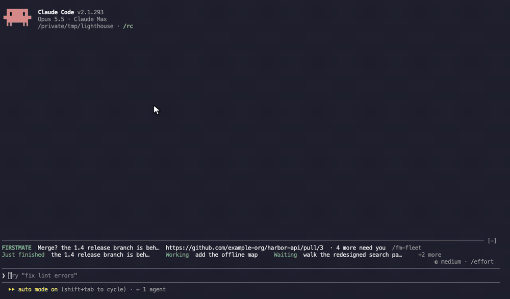
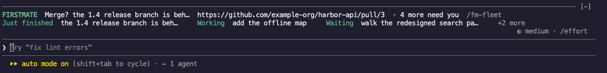
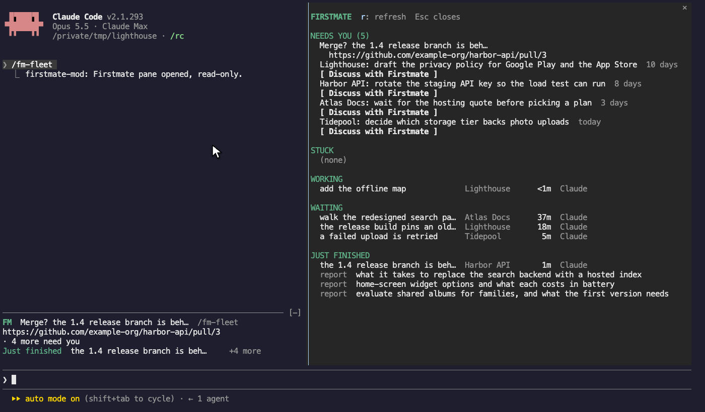
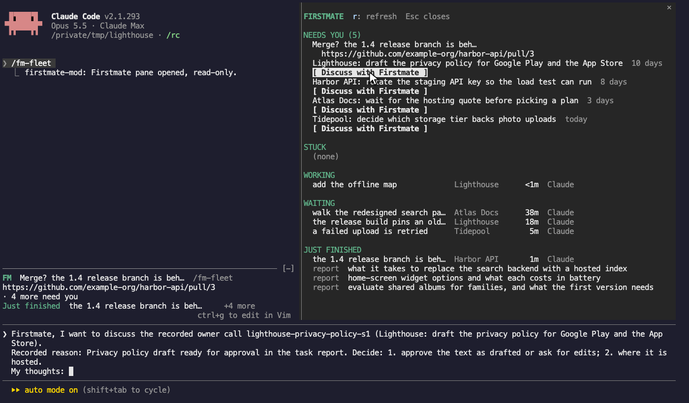

# firstmate-mod

[](https://github.com/dctmfoo/firstmate-mod/actions/workflows/ci.yml)
[](LICENSE)

A [Claude Code](https://code.claude.com) plugin that shows your [Firstmate](https://github.com/kunchenguid/firstmate) fleet inside the Claude session: what needs you, and what every worker is doing.

It adds a two-row band above the prompt and a `/fm-fleet` pane. The pane's **Discuss with Firstmate** button puts an editable draft about a recorded call in your prompt box, so you can answer Firstmate without retyping the context.



<sub>The recording uses the made-up demo home in [`fixtures/demo-home`](fixtures/demo-home). [MP4 version](docs/media/discuss.mp4).</sub>

The mod is read-only. It reads one Firstmate home, Herdr's agent list and a quota command. It never writes to the home, and it never dispatches, steers, resolves or merges anything. Discuss only fills your prompt box; you decide whether to send.

## Requirements

- **Claude Code** with plugin mods (early access; tested with 2.1.293). The mods API changes between releases, so a newer Claude Code may need a newer version of this plugin.
- **A Firstmate home**: the directory with Firstmate's `state/` and `data/` folders.
- **[Herdr](https://herdr.dev)**, reachable from the Claude session as `herdr agent list`, for live worker state. Run Claude Code inside Herdr, or point the `herdr_command` option at it.
- **quota-axi** (optional), for the low-headroom line and toast. Without it, everything else works and the headroom line stays hidden.

## Install

Load the plugin for a session:

```sh
git clone https://github.com/dctmfoo/firstmate-mod.git
claude --plugin-dir ./firstmate-mod
```

Then set the Firstmate home, either with `/config` (the plugin's `home` row) or in `~/.claude/settings.json`:

```json
{
  "pluginConfigs": {
    "firstmate-mod@inline": {
      "options": { "home": "/absolute/path/to/your/firstmate" }
    }
  }
}
```

Until a home is set, the band asks you to set the `home` option and the mod reads nothing. The home must be an absolute path.

### Options

The [plugin manifest's `userConfig`](.claude-plugin/plugin.json) owns option descriptions, defaults and limits. Use `herdr_command` and `quota_command` to choose the executables, `herdr_seconds`, `summary_seconds` and `headroom_seconds` to change read intervals, and `headroom_toast_percent` to configure headroom toasts.

### Try it without Firstmate

The repository ships a made-up demo home. Copy it with its clock moved to now, then point the plugin at the copy and its stand-in commands:

```sh
bun scripts/demo-home.ts /tmp/fm-demo
```

```json
{
  "pluginConfigs": {
    "firstmate-mod@inline": {
      "options": {
        "home": "/tmp/fm-demo",
        "herdr_command": "/tmp/fm-demo/bin/herdr",
        "quota_command": "/tmp/fm-demo/bin/quota-axi"
      }
    }
  }
}
```

## The band



**Row 1 is yours.** It says `Nothing needs you`, or what does:

- A pull request that is yours to merge shows its full link: `Merge? <name>  <url>  · 4 more need you`.
- Otherwise it counts the recorded calls waiting on you and names the oldest with its age: `3 need you · oldest: <call>, 10 days`.
- Calls you parked with a date are not counted. If Firstmate's summary has never been readable, the row says `can't read Firstmate's list`.

**Row 2 is the crew.** Every worker by plain name, with how long it has been in its current state, worst news first:

| Group | Meaning |
| --- | --- |
| **Stuck** | A question on its screen, a closed window, a worker quiet for more than 10 minutes whose last word was `working`, `resolved` or nothing, or one that said `blocked` or `failed`. The reason follows the name. |
| **Just finished** | A quiet or closed worker that said `done`. It leaves the band after an hour. |
| **Working** | Herdr says the pane is working, reports an unknown state, or a quiet pane is still inside the 10-minute grace period. |
| **Waiting** | The worker said `paused`, or `needs-decision` (shown as `for Firstmate`), and its pane is quiet. |

A worker's name is its backlog title without the project prefix, cut at the first `;`, `,` or `(`, then to 30 columns. A task the backlog does not list is named by its task id. When the row is too long, the times go first, then workers are folded into `+N more`, worst news last. Narrow terminals shorten `FIRSTMATE` to `FM` and wrap row 1; a link is never cut.

## The pane

`/fm-fleet`, or the `/fm-fleet` button on the band, opens one view: Needs you, Stuck, Working, Waiting, then Just finished. Press `r` to re-read and Esc to close it.



- **Needs you** lists merges first, then calls oldest first. Each call has a **Discuss with Firstmate** button.
- **Stuck, Working, Waiting** list each worker with its project, time in state and harness. A stuck worker's reason sits under its name.
- **Just finished** lists workers that said `done` in the last hour, then what landed today (merged pull requests with their full link, scout reports).
- **Parked with you** names calls parked with a date.
- A `Low on headroom` line appears only when a provider's tightest fresh limit is at or below 20%.

### Discuss

Discuss inserts a draft like this into the prompt box. Nothing is sent until you press Enter:

```text
Firstmate, I want to discuss the recorded owner call lighthouse-privacy-policy-s1 (Lighthouse: draft the privacy policy for Google Play and the App Store).
Recorded reason: Privacy policy draft ready for approval in the task report. Decide: 1. approve the text as drafted or ask for edits; 2. where it is hosted.
My thoughts:
```



### Other commands and signals

- `/fm-refresh` re-reads everything now. It only reads; it runs no session start, reconcile or supervision.
- The status line (`⚠ firstmate-mod: …`) carries summary or crew read failures, in the words of the failure. Quota failures have no visible error indicator.
- Toasts fire for changes after a silent first read: something that newly needs you, a newly merged pull request, a worker that newly got stuck, or a provider entering the headroom threshold. `/clear` starts a new silent baseline; reload and resume keep what was already announced.

## How worker state is worked out

Herdr knows whether a pane is working, quiet, blocked or gone, but not whether a quiet worker finished or is waiting, and it keeps no times. So each worker's Herdr state is joined with the newest typed line of its own `state/<id>.status`:

| Herdr | Newest status line | Shown as | Time since |
| --- | --- | --- | --- |
| working | anything | Working | Herdr turned `working` |
| unknown or unrecognized | anything | Working | Herdr turned `unknown` |
| blocked | anything | Stuck: question on its screen | Herdr turned `blocked` |
| idle or done | `paused` | Waiting | that line |
| idle or done | `needs-decision` | Waiting: for Firstmate | that line |
| idle or done | `blocked`, `failed` | Stuck | that line |
| idle or done | `done` | Just finished (one hour) | that line |
| idle or done | `working`, `resolved` or none | Working; after 10 minutes Stuck: stopped without a word | Herdr turned quiet |
| no pane listed | `done` | Just finished (one hour) | that line |
| no pane listed | anything else | Stuck: window closed | Herdr stamp |

The mod stamps each change in Herdr state with the time of the read that saw it. On first sighting it seeds that stamp from the newest status line's `[at=…]`, then the task's spawn time (`spawn_gen` in its metadata), then the read time, so a first-seen time can be off. Nothing reads a screen.

## What it reads

Every read goes through Claude Code's `$.fs` or `$.process.run` (by argv, never a shell) on timers outside drawing. Drawing only reads cached session state.

| Lane | Reads |
| --- | --- |
| Crew | `herdr agent list`, one listing of `state/`, changed `state/<id>.meta` files and each tracked worker's changed `state/<id>.status` file. While workers are tracked, it also checks `data/backlog.md` and reads it when its mtime changed. |
| Summary | `state/home-summary.json` (schema checked in [`hooks/normalize.ts`](hooks/normalize.ts)). For merge asks it also uses `data/backlog.md` and a listing of `state/` to drop asks Firstmate's own records show settled. |
| Headroom | `quota-axi --provider claude,codex --json --no-credential-refresh`. |

A worker is a task whose `state/<id>.meta` names a `herdr_tab_id`; that tab id is the join key to Herdr's agent list. Task ids are checked against [`TASK_ID`](hooks/sources.ts) before they are put on a path. No lane overlaps itself, and a failed read keeps the last good value. The mod calls no write API: `claude plugin validate` lists every engine call the module makes, and `$.fs.write` is not among them.

The crew lane takes regular files' mtimes from the listing; a non-file status entry needs a separate stat. Changed metadata files are read in parallel, then changed status files are read in parallel. A changed metadata file can move a worker to a new Herdr tab, and changed backlog text refreshes worker names. If an individual file read fails, its cached metadata, status or title remains until a later read succeeds. An unknown backlog mtime forces a read.

A missing status file, or a non-file status entry whose stat fails, clears its cached line. A first metadata read failure skips that worker; a first backlog read failure leaves task ids as names.

A merge ask leaves Needs you as soon as the backlog shows its task closed, or neither a backlog row nor `state/<id>.meta` exists for it, without waiting for Firstmate's next forge poll. An unreadable backlog, or a task id that fails the check, leaves the ask visible.

## Development

See [CONTRIBUTING.md](CONTRIBUTING.md) for setup, checks, text previews and fixture generation, and [docs/design.md](docs/design.md) for the design rationale.

## Scope

This release reads one Firstmate home. It has no approve, merge, dispatch or steer action, and it does not include secondmate homes or a shell `statusLine`.

## License

[MIT](LICENSE)
